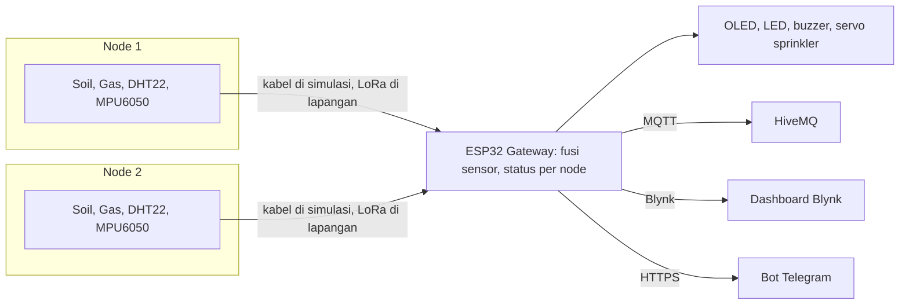

# SAGAMORE

Sistem deteksi dini kebakaran hutan dan lahan (karhutla) berbasis IoT, dibuat dan disimulasikan di Wokwi dengan ESP32.

> Samsung Innovation Campus Batch 8, Selection Phase 2: IoT Device and Hardware Discovery

- **Team:** [Nama Team]
- **Anggota:** [Nama 1], [Nama 2], [Nama 3]
- **Institusi:** [Nama sekolah atau universitas]
- **Proyek Wokwi:** [tempel link Wokwi]
- **Video demo:** [tempel link video]

## Latar belakang singkat

Karhutla sering baru diketahui setelah api membesar, dan sensor di lapangan bisa rusak, dicuri, atau terbakar tanpa ada yang tahu. SAGAMORE menggabungkan beberapa sensor untuk mendeteksi kondisi rawan dan kebakaran, memberi respons otomatis, dan memperlakukan **hilangnya data sensor sebagai tanda bahaya** ("absence is data").

## Fitur

- Pemantauan 2 node sensor: kelembapan tanah, gas, suhu, dan getaran (tamper).
- Empat status per node: **AMAN, WASPADA, BAHAYA, HILANG**.
- Deteksi kebakaran dengan fusi sensor (gas dan suhu), bukan satu sensor saja.
- Sprinkler otomatis (servo) di node yang berstatus BAHAYA.
- Output lokal: OLED, 3 LED, buzzer. Tetap berfungsi walau jaringan putus.
- Komunikasi MQTT (HiveMQ), dashboard Blynk, dan notifikasi Telegram.

## Arsitektur



Di simulasi, satu ESP32 mewakili gateway dan kabel mewakili link LoRa dari tiap node. Di implementasi nyata, tiap titik sensor memakai MCU kecil dengan modul LoRa.

## Komponen

| Komponen | Jumlah | Fungsi |
|---|---|---|
| ESP32 DevKit V1 | 1 | Pengolah utama dan gateway |
| Potensiometer (stand-in sensor tanah) | 2 | Kekeringan tanah |
| Gas sensor (stand-in MQ-7) | 2 | Asap dan gas pembakaran |
| DHT22 | 2 | Suhu udara |
| MPU6050 | 2 | Deteksi tamper |
| Servo | 2 | Sprinkler pemadam awal |
| OLED SSD1306 128x64 | 1 | Tampilan lokal |
| LED hijau, kuning, merah | 3 | Indikator status |
| Buzzer | 1 | Alarm suara |
| Resistor 220 ohm | 3 | Pembatas arus LED |

## Pin yang digunakan

| Fungsi | Node 1 | Node 2 | Jenis |
|---|---|---|---|
| Soil moisture | D35 | D34 | Analog (ADC1) |
| Gas sensor | D32 | D33 | Analog (ADC1) |
| DHT22 | D5 | D14 | Digital |
| MPU6050 | 0x69 | 0x68 | I2C |
| Servo sprinkler | D18 | D23 | PWM |

| Fungsi | Pin |
|---|---|
| I2C SDA, SCL (MPU6050 x2 dan OLED 0x3C) | D21, D22 |
| LED hijau, kuning, merah | D25, D26, D27 |
| Buzzer | D19 |
| Daya servo | VIN (5V) |
| Daya sensor dan OLED | 3V3 |

## Logika status

| Status | Syarat |
|---|---|
| HILANG | DHT22 NaN atau MPU6050 gagal dibaca, 3 siklus berturut-turut |
| BAHAYA | Gas > 3000 **dan** suhu > 55 °C |
| WASPADA | Gas > 2000, atau suhu > 40 °C, atau tanah > 70% kering, atau tamper |
| AMAN | Selain di atas |

- Tamper: besar percepatan menyimpang dari 1 g lebih dari 0,3 g.
- Status sistem adalah yang terburuk, dengan prioritas BAHAYA, HILANG, WASPADA, AMAN. Status ini mengatur LED dan buzzer.
- Sprinkler mengikuti status tiap node. Mati setelah 2 siklus tidak BAHAYA.
- Siklus lokal berjalan tiap 2 detik.

## Komunikasi MQTT

Broker: `broker.hivemq.com`, port 1883. Awalan topik: `rainforestguard_cetta/`.

| Topik | Isi |
|---|---|
| `.../node1/temperature`, `.../node2/temperature` | Suhu (°C) |
| `.../nodeN/gas` | Nilai ADC gas |
| `.../nodeN/soil_moisture` | Persen kekeringan |
| `.../nodeN/status` | 0 AMAN, 1 WASPADA, 2 BAHAYA, 3 HILANG |
| `.../nodeN/tamper` | 0 atau 1 |
| `.../nodeN/sprinkler` | 0 atau 1 |
| `.../nodeN/latitude`, `.../nodeN/longitude` | Koordinat node |
| `.../system/status` | Status sistem (kode sama) |

Subscribe ke `rainforestguard_cetta/#` untuk melihat semua data.

## Cara menjalankan

1. Buka proyek Wokwi (link di atas) atau buat proyek ESP32 baru, lalu salin `sketch.ino`, `diagram.json`, dan `libraries.txt` dari repo ini.
2. Isi kredensial di bagian atas `sketch.ino`:
   ```cpp
   #define BLYNK_TEMPLATE_ID   "ISI_TEMPLATE_ID"
   #define BLYNK_AUTH_TOKEN    "ISI_TOKEN_BLYNK"
   const char* BOT_TOKEN = "ISI_TOKEN_BOT_TELEGRAM";
   ```
3. **Blynk (opsional):** buat template dengan datastream V0 sampai V15.

   | Fungsi | Node 1 | Node 2 |
   |---|---|---|
   | Suhu | V0 | V8 |
   | Gas | V1 | V9 |
   | Kekeringan | V2 | V10 |
   | Status | V3 | V11 |
   | Tamper | V4 | V12 |
   | Sprinkler | V5 | V13 |
   | Latitude | V6
